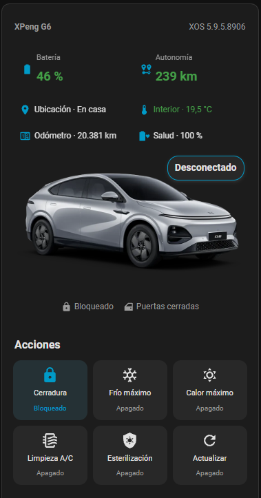
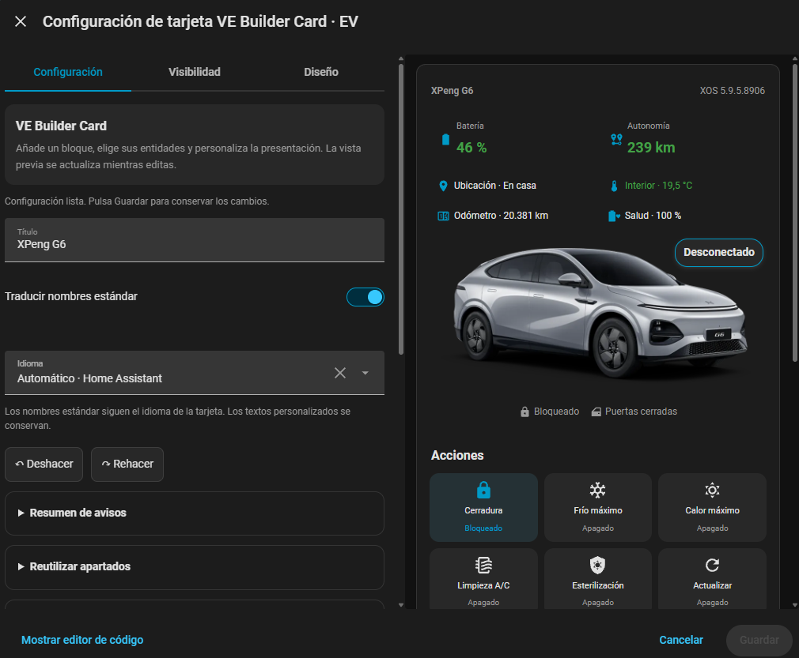
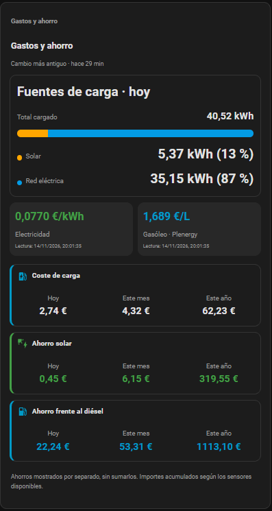
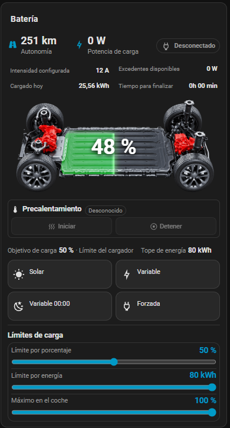
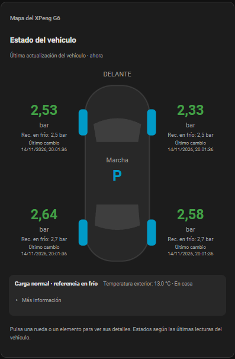

# VE Builder Card

[English](https://github.com/sergey08/ve-builder-card/blob/main/README.md) · **Español**

[](https://my.home-assistant.io/redirect/marketplace_repository/?owner=sergey08&repository=ve-builder-card&category=plugin)

Crea tu propio panel del vehículo en Home Assistant. Combina información del coche, controles de carga, ubicación, gastos y un esquema del vehículo desde un editor visual. Utiliza las entidades que ofrecen tus integraciones; la tarjeta no requiere una cuenta del fabricante.

## Versión estable 1.8.1 — Tarjeta Batería compacta

El panel de **Fuentes de carga** admite potencia instantánea (W/kW) y energía diaria acumulada (kWh/Wh). En el editor visual, selecciona **Automático**, **Potencia (W)** o **Energía diaria (kWh)** y asigna las entidades solar, red y total (se admiten `sensor.*` e `input_number.*`).

En modo energía diaria, aparece el **total cargado encima de una barra completa** dividida por colores entre energía solar y red eléctrica. Debajo figura una leyenda con kWh y porcentajes. La energía de origen desconocido se deja sin rellenar; las pequeñas diferencias de redondeo se normalizan si todas las fuentes están disponibles. Se ha corregido el margen superior de 6 píxeles que dejaba una franja gris sobre los segmentos. El modo de potencia mantiene las barras animadas. No se modifican automáticamente las tarjetas existentes.

### Ejemplo de energía diaria para XPeng G6

```yaml
charging_sources:
  mode: energy
  solar_entity: sensor.xpeng_energia_carga_solar_diaria
  grid_entity: input_number.xpeng_energia_carga_red_diaria
  total_entity: sensor.energia_cargada_diaria
```

Aspecto visual confirmado por el usuario en Home Assistant con la beta.5 antes de liberar la versión estable.

### Batería

Las lecturas de Batería siguen el tema del panel y se muestran sin cajas grises. El chasis tiene fondo transparente y sigue disponible sin conexión.

Batería reduce ligeramente las cifras de autonomía y potencia, compacta el precalentamiento y coloca la intensidad, los excedentes, lo cargado hoy y el tiempo restante bajo los indicadores principales.

Batería ocupa menos espacio. Los objetivos y límites de carga usan cifras más pequeñas y las lecturas de potencia se agrupan en una cuadrícula compacta. La intensidad configurada se muestra sin botones de ajuste.

Batería muestra el menor límite porcentual configurado y su origen, con el tope de energía aparte. Una entidad de texto puede indicar el motivo de espera. El editor permite añadir, eliminar y ordenar modos y vincular sus entidades. La tarjeta independiente Batería omite el título superior.

Autonomía y potencia de carga se muestran sin decimales. Pulsa sobre la autonomía, la potencia o el chasis para abrir su entidad. La batería muestra bandas de luz en movimiento durante la carga y el bloque de potencia queda visible.

Los botones de precalentamiento ocupan todo el ancho, los modos de carga se muestran en dos columnas y el deslizador opcional **Máximo en el coche** permite ajustar el límite del vehículo dentro de su rango admitido.

La sección Batería muestra el porcentaje sobre un chasis 3D, junto con la autonomía, la potencia de carga y el estado del cable. Las secciones existentes tituladas «Modos de carga» se muestran como Batería y conservan sus entidades y acciones. Los bloques de selección genéricos mantienen su presentación. También puedes añadir un bloque Batería desde el editor visual.

En los ajustes de Batería puedes elegir los sensores manualmente o reutilizar las lecturas del bloque de inicio. Si hay un único bloque de potencia o de límites, la primera sección Batería muestra los límites y agrupa las lecturas adicionales en **Potencia de carga**. Si hay varios, selecciona uno de forma explícita o elige **Mantener separado**. Selecciona una entidad para mostrar la intensidad configurada.

Para XPengTK 0.6.49, activa **Mostrar precalentamiento** y selecciona el sensor de estado y la entidad objetivo del vehículo. Los servicios configurables son `xpeng.start_battery_preheating` y `xpeng.stop_battery_preheating` de forma predeterminada. Cada acción requiere confirmación. Los botones se desactivan si el estado es desconocido o no está disponible. Deja el precalentamiento desactivado si el vehículo no lo admite.

En HACS o Marketplace, actualiza VE Builder Card a `v1.8.1` y recarga el panel. Si utilizas una beta, selecciona la versión estable en **Volver a descargar**.

## Instalar desde el Marketplace

VE Builder Card está en el catálogo predeterminado del Marketplace, integrado en Home Assistant desde la versión 2026.11.

1. Abre **Ajustes → Marketplace** y busca **VE Builder Card**, o usa el botón **Abrir en Marketplace** de arriba.
2. Abre la ficha de la tarjeta, pulsa **Instalar** y confirma.
3. Recarga el navegador, edita tu panel y elige **VE Builder Card** en el selector de tarjetas.

La vista previa usa valores de ejemplo. Selecciona tus entidades en el editor para ver datos reales. Si aparece una entrada duplicada de una copia local antigua, elimina el recurso de esa copia.

Si gestionas los recursos del panel en YAML, añade el módulo JavaScript que indica el cuadro de instalación del Marketplace.

Home Assistant 2026.11 migra automáticamente al Marketplace las instalaciones de esta tarjeta hechas con HACS.

## Idiomas disponibles

La tarjeta y el editor visual admiten **7 idiomas**:

| Idioma | Código |
| --- | --- |
| Inglés · English | `en` |
| Español | `es` |
| Portugués · Português | `pt` |
| Francés · Français | `fr` |
| Alemán · Deutsch | `de` |
| Italiano | `it` |
| Neerlandés · Nederlands | `nl` |

El idioma se elige por separado para cada tarjeta en el desplegable del editor visual. **Automático** sigue el idioma de Home Assistant. Los nombres estándar se traducen; los títulos, nombres y textos personalizados se conservan.

**Versión estable: 1.8.1.** [Cambios de esta versión](https://github.com/sergey08/ve-builder-card/releases/tag/v1.8.1).

## Nombres estándar e idioma de la tarjeta

Los nombres estándar guardados siguen ahora el idioma de la tarjeta en inglés, español, portugués, francés, alemán, italiano y neerlandés: títulos de bloques, modos de carga, acciones, límites, costes y periodos. Solo se reconocen coincidencias completas; se conservan los textos personalizados y los nombres propios de los sensores. Desactiva **Traducir nombres estándar** en el editor (`translate_standard_labels: false`) para mostrar literalmente el texto guardado. El idioma se configura por tarjeta; **Automático** sigue Home Assistant. No se reescribe la configuración existente.


## Versión OTA en la cabecera

En **Inicio con imagen**, selecciona opcionalmente el sensor de versión OTA (`ota_version_entity`) y el sensor de estado de actualización (`ota_status_entity`). La tarjeta lee el atributo `current_version` (o un estado válido), muestra el nombre del sistema y su versión a la derecha del título y añade una exclamación ámbar solo cuando hay una actualización pendiente. Si dejas vacío el sensor de versión, no se muestra nada. Ejemplo para XPeng Toolkit: `sensor.ota_update_xpeng_135818` y `sensor.ota_status_xpeng_135818`.

## Capturas — VE Builder Card

Estas imágenes corresponden a una configuración real del XPeng G6 en Home Assistant. Los valores y las acciones disponibles dependen de las integraciones instaladas por cada usuario.

| Vista general | Editor visual |
|:--:|:--:|
|  |  |
| Batería, autonomía, imagen del coche y controles | Configuración de campos y bloques con vista previa, sin escribir YAML |

| Gastos y ahorro | Batería |
|:--:|:--:|
|  |  |
| Barra de energía solar/red, total diario y ahorros | Nivel de batería, precalentamiento, modos y límites de carga |

**Estado del vehículo**



Presiones de las cuatro ruedas, marcha y consejos según las condiciones.

## Diseña tu tarjeta

Selecciona uno o varios apartados entre Coche y acciones, Batería, Mapa y Gastos y ahorro, y añádelos juntos. La configuración por bloques sigue disponible en Configuración avanzada. Usa **Buscar entidades** dentro de cada apartado para filtrar sus selectores por dispositivo. El editor indica cuántas entidades habilitadas tiene el dispositivo. Abre el selector de un campo para elegir una entidad compatible. Inicio con imagen muestra una ilustración por defecto hasta que elijas otra imagen.

Pon un título, añade apartados y elige las entidades. Cambia los nombres de apartados y campos, añade o elimina elementos y arrastra campos o apartados para ordenarlos. El editor permite elegir tamaño, anchura, iconos, unidades, decimales y presentación como información, botones o barras. Puedes deshacer y rehacer durante la sesión de edición.

Empieza con una plantilla de vehículo eléctrico, vehículo de combustión, gastos o mapa del vehículo. Las plantillas no traen sensores preasignados. Cada tarjeta tiene su propia configuración. El filtro opcional por dispositivo facilita encontrar entidades sin cambiar su dispositivo asignado.

| Apartado | Qué puedes configurar |
| --- | --- |
| Inicio | Imagen del vehículo, campos compactos, conector, estado de carga y potencia real de carga |
| Información | Valores, botones y barras de progreso con tamaño, anchura y aspecto configurables |
| Carga | Campos numéricos y barra de potencia con escala propia |
| Modos de carga | Controles switch e input_boolean |
| Límites | Deslizadores input_number con el mínimo, máximo y paso del ayudante |
| Acciones | Interruptores, cerraduras y botones con acciones al pulsar |
| Mapa de ubicación | Mapa nativo de Home Assistant con entidades person o device_tracker, zoom e historial |
| Gastos y ahorro | Precios de referencia de electricidad y combustible, grupos de importes, unidades, decimales y comentarios |
| Mapa del vehículo | Presión de los cuatro neumáticos, marcha, cuatro puertas, capó y maletero sobre el esquema del coche; unidades de presión, fechas y comentarios |

### Consejos de presión y carga

Puedes seleccionar **Origen de la temperatura → Según la ubicación**. Configura la entidad de ubicación, su estado en casa (por defecto `home`), el sensor exterior de casa y el del vehículo para fuera. No utiliza temperatura de casa fuera de ella. Si la ubicación es desconocida o el sensor seleccionado no tiene lectura reciente válida, lo indica sin sustituirlo por el de otra ubicación. El modo sensor fijo sigue disponible.

El perfil y la temperatura se presentan de forma compacta; el origen del sensor y los consejos están en **Más información**. El resumen distingue avisos críticos y avisos de advertencia.

El cuadro de consejos muestra la temperatura exterior utilizada y el nombre del sensor; indica expresamente si falta una lectura válida reciente.

En **Editar → Mapa del vehículo → Consejos y perfiles de presión**, activa los consejos y elige carga normal o plena carga. Introduce las referencias por eje de la etiqueta del vehículo: el perfil no modifica los umbrales de aviso. Puedes seleccionar temperatura exterior (°C/°F, antigüedad máxima configurable: 30 minutos por defecto) y un sensor cuyo valor sea la fecha de fin del último trayecto (ISO/Unix). Se indica circulación reciente durante 2 horas y se muestra un consejo con 30 °C o más. Si falta contexto, se muestra condición térmica desconocida. No cambia presiones por ser verano ni confirma que las ruedas estén frías. [Consejos de Michelin](https://www.michelin.es/auto/consejos/presion-de-los-neumaticos/inflar-neumaticos).

### Resumen de avisos

Activa **Editar → Resumen de avisos** para mostrar una lista compacta y desplegable de valores y presiones en aviso o crítico, aperturas confirmadas y lecturas antiguas. Puedes desactivar cada categoría. Utiliza las entidades y umbrales de esta tarjeta, incluidos los límites de presión por eje y los ajustes de antigüedad activados. Desaparece cuando no hay avisos. Pulsa un elemento para ver sus detalles; no envía órdenes al vehículo ni notificaciones.

### Mapa del vehículo

Asigna cada sensor de presión y elige bar, kPa o psi. Opcionalmente, añade la marcha y los sensores de apertura de las cuatro puertas, el capó y el maletero. Configura los valores que significan abierto y cerrado en tu integración. Los indicadores de apertura aparecen solo cuando el sensor configurado confirma que esa parte está abierta; los estados cerrado, desconocido o no disponible no muestran un indicador de apertura. El esquema muestra información; no acciona puertas ni cerraduras.

### Visualización de la carga

La manguera permanece visible y quieta cuando el coche está conectado sin recibir energía. Configura **Potencia real de carga** para distinguir la carga de la espera: si hay una entidad de potencia, su lectura positiva determina la carga y la animación, aunque el estado del vehículo llegue con retraso. Con potencia cero queda en espera y se indica expresamente si la potencia no está disponible. Sin entidad de potencia, sigue el estado de carga. Se respeta la preferencia de movimiento reducido.

### Lluvia sobre el vehículo

En **Editar → Inicio → Lluvia sobre el vehículo**, activa la capa y selecciona una entidad meteorológica, sensor binario de lluvia o sensor de precipitación actual. Elige intensidad decorativa ligera, normal o intensa y animación. Sin datos recientes de lluvia no hay efecto (antigüedad máxima de 180 minutos por defecto). La preferencia de movimiento reducido deja el efecto estático.

Si usas un sensor de casa, puedes restringirlo a cuando el coche esté en casa. **Coche bajo techo** o un sensor de cobertura oculta la lluvia en el garaje. La **Vista previa de lluvia (datos de ejemplo)** permite probar el aspecto; lleva etiqueta e ignora sensores, ubicación y techo, por lo que debe desactivarse después. No trae entidades preasignadas. Se usan condiciones actuales según [Home Assistant](https://www.home-assistant.io/integrations/weather/), no previsiones ni lluvia acumulada.

### Estados bajo el vehículo

En **Editar → Inicio → Estados bajo el vehículo**, añade indicadores de cerradura, puertas o ventanillas. Selecciona cada entidad y personaliza opcionalmente nombre, icono, valores normal/de aviso y textos. Arrastra para ordenar o elimina los que no necesites. Estados normales discretos; aperturas y desbloqueado en ámbar. Lecturas desconocidas muestran Sin datos. Al pulsar solo abre detalles, nunca acciona cerraduras ni ventanas.

Valores por defecto según entidad: locked/unlocked para lock, closed/open para cover y off/on para sensores binarios. Si usas un sensor conjunto de puertas o ventanillas, las etiquetas corresponden al significado de ese sensor; los sensores individuales pueden llevar nombres propios. No hay entidades preasignadas.

### Imágenes e idiomas

Utiliza una URL de imagen o una ruta `/local/` de Home Assistant en el apartado Inicio. La interfaz admite **inglés, español, portugués, francés, alemán, italiano y neerlandés**, sigue automáticamente el idioma de Home Assistant y permite elegirlo desde el editor. Los títulos, nombres de campos y comentarios personalizados se conservan tal como los escribas.

## Instalación manual

Descarga `ve-builder-card.js` de la [última versión](https://github.com/sergey08/ve-builder-card/releases/latest), cópialo a `/config/www/ve-builder-card.js` y registra `/local/ve-builder-card.js` como módulo JavaScript. El tipo de tarjeta es `custom:ve-builder-card`.

## Actualizaciones y ayuda

Consulta los cambios en las [notas de versión](https://github.com/sergey08/ve-builder-card/releases) o [comunica un problema](https://github.com/sergey08/ve-builder-card/issues) indicando la versión de Home Assistant, la versión de la tarjeta y una configuración sin datos privados.

Para contribuir, `npm run check` comprueba la sintaxis JavaScript, ejecuta las pruebas automáticas y genera el archivo distribuible. El funcionamiento en móvil se ha confirmado en la instalación del mantenedor. Las pruebas automáticas no sustituyen la revisión visual en distintos dispositivos; consulta la [lista de validación](https://github.com/sergey08/ve-builder-card/blob/main/docs/QA.md).

Licencia MIT.

## Asistente inicial

Abre **Asistente inicial** en el editor visual, elige el tipo de vehículo y el dispositivo, y marca los apartados que necesitas. Pulsa **Buscar entidades**, revisa cada sugerencia y selecciona **Añadir apartados revisados**. Las sugerencias usan nombres de entidad en español e inglés y unidades compatibles. Las coincidencias ambiguas quedan vacías; puedes asignar o quitar cualquier entidad antes de aplicar. La ubicación se elige manualmente. Se conservan los apartados existentes y puedes deshacer la incorporación. Las sugerencias no envían órdenes al coche.

## Colores según el valor

Dentro de un campo numérico, abre **Colores según el valor** y actívalo. Elige valores bajos o altos y los umbrales de aviso y crítico. Ejemplo de batería: bajo, aviso 40 y crítico 20 muestra verde por encima del 40%, ámbar entre el 20% y el 40% (sin incluir el 20%) y rojo al 20% o menos. Los umbrales incluyen el valor indicado. Para neumáticos, configura los colores en el Mapa del vehículo usando su unidad de presentación. Sin datos no se aplica color. Es opcional y no cambia la configuración existente. [Mejoras pendientes](https://github.com/sergey08/ve-builder-card/blob/main/docs/ROADMAP.md).

Puedes configurar colores independientes para **eje delantero** y **eje trasero**. Sin configuración propia, cada eje usa los colores comunes; si desactivas su configuración propia, ese eje queda sin colorear. Los umbrales son avisos visuales, no presiones de inflado ni tolerancias oficiales.

En **Presiones recomendadas**, introduce los valores en frío para delante y detrás, en bar. Aparecen en pequeño bajo cada lectura y se convierten si cambias la unidad mostrada. Vacío o 0 oculta la referencia. Usa la etiqueta de tu vehículo.

## Antigüedad de las lecturas

En Editar, abre un apartado y **Antigüedad de las lecturas**. Activa la opción y elige a partir de cuántos minutos considerar los datos antiguos (por defecto 60). Puedes seleccionar un sensor cuyo valor sea la fecha real de lectura, en ISO o Unix. Si no lo configuras, se muestra el cambio más antiguo de las entidades del apartado, identificado como tal: un valor estable puede seguir siendo válido. Los datos antiguos se atenúan sin bloquear controles; no significa que el coche esté averiado.

## Exportar e importar tarjetas completas

En **Editar → Exportar e importar tarjeta**, descarga una copia JSON con entidades o desmarca **Incluir entidades en la exportación** para compartir un diseño. Se conservan títulos, notas y URL de imágenes; revísalos antes de compartir. No incluye lecturas del vehículo ni archivos de imagen.

Abre un archivo JSON o pega su contenido y pulsa **Revisar importación**. La vista previa muestra apartados, campos y entidades no disponibles. **Añadir solo los apartados** conserva el título y los ajustes actuales; **Reemplazar esta tarjeta** importa la configuración completa. Admite deshacer y rehacer y debes Guardar la tarjeta. Los elementos importados reciben identificadores independientes. No crea entidades ni envía órdenes. Límite del archivo: 512 KB. Las imágenes locales y entidades deben existir en la instalación de destino.

## Reutilizar apartados

Pulsa **Copiar apartado** al final de un bloque. En otra tarjeta del mismo panel abre **Editar → Reutilizar apartados → Pegar apartado**. Conserva entidades y estilo en una copia independiente. Revisa entidades y guarda. La copia temporal desaparece al recargar la página.
